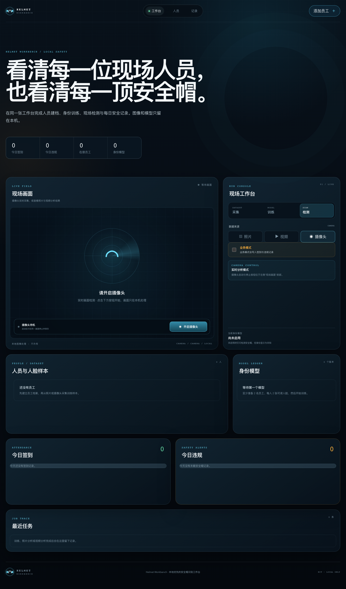

# Helmet Workbench

**安全帽智能识别与员工身份工作台**

[English](docs/README.en.md) · [产品架构](docs/architecture.md) · [隐私说明](docs/privacy.md) · [模型卡](docs/model-card.md) · [MIT License](LICENSE)

Helmet Workbench 将原先分散的 YOLO 检测、人脸分类、PyQt 页面、SQLite 查询和视频播放整合为一个本地优先的 Web 产品。用户可以在同一张工作台完成员工建档、人脸样本采集与训练、安全帽检测、摄像头签到、违规记录和每日统计。



> 截图来自真实运行页面，使用空数据集，不包含员工、人脸样本或现场影像。

## 产品特点

- **一个入口完成完整安全闭环**：员工建档 → 人脸采集 → 模型训练 → 模型启用 → 现场检测 → 签到和违规记录。
- **三种现场来源**：支持照片、视频和浏览器摄像头；摄像头业务模式可写入正式签到与违规记录。
- **清晰的现场画面**：摄像头未启动时统一显示“请开启摄像头”，启动、实时状态和停止保存都在同一画面内完成。
- **安全帽与身份同时识别**：YOLO 判断已戴帽/未戴帽，Haar + CNN 完成员工身份识别，低置信度结果显示为未知。
- **弹窗式员工建档**：点击右上角“添加员工”会打开居中表单，不会把用户带到页面中部的隐藏区域。
- **员工数据可管理**：可以删除单个样本、继续采集、停用员工并保留历史业务记录。
- **本地优先**：默认只监听 `127.0.0.1`，图片、视频、模型、证据和数据库均保存在本机，不上传外部服务。
- **任务与模型可追踪**：训练和批量分析使用持久化任务记录，模型历史、指标、阈值和标签顺序均可查询。
- **响应式工作台**：覆盖桌面和移动端，支持键盘焦点、语义标签和减少动态效果偏好。

## 使用流程

1. 添加至少 2 名员工。
2. 为每名员工从照片或摄像头采集至少 2 张可读人脸。
3. 训练身份模型；首个模型训练完成后自动启用。
4. 选择照片、视频或摄像头进行安全帽检测。
5. 需要正式业务记录时，在摄像头模式下开启“业务模式”。
6. 在“今日签到”“今日违规”和任务区域查看结果。

照片和视频默认只分析，不写入正式签到或违规；只有摄像头业务模式会生成正式记录。每位员工每天的签到和违规记录各保留一次。

## 工作台交互

- 右上角“添加员工”打开独立弹窗，填写员工编号和姓名后立即回到当前工作台。
- 左侧“现场画面”负责摄像头实时画面、照片预览和视频分析结果显示。
- 摄像头未启动时显示“请开启摄像头”；开启后，同一底部控制条会切换为“停止并保存结果”。
- 采集模式下先在右侧选择员工，再在现场画面底部启动摄像头；停止后会自动保存人脸样本并刷新人员列表。
- 检测模式下可在右侧切换业务模式；正式签到和违规记录只在摄像头业务模式中产生。

## 快速开始

### 环境要求

- Python 3.11 或 3.12
- Node.js 20+
- pnpm 10+
- 现代浏览器，摄像头功能需要用户授权

### 安装与启动

```bash
git clone https://github.com/panvv-ai/Helmet-Identification.git
cd Helmet-Identification

uv sync --extra dev
pnpm --dir frontend install
pnpm --dir frontend build

uv run python main.py
```

打开 <http://127.0.0.1:8000>。

默认启动命令会自动完成运行目录、数据库和模型准备，然后启动工作台。安全帽模型通过 GitHub Release 分发并经过 SHA-256 校验，不进入源码仓库。

### 前端开发模式

终端一：

```bash
uv run python main.py serve
```

终端二：

```bash
pnpm --dir frontend dev
```

开发页面位于 <http://127.0.0.1:5173>，`/api` 和 WebSocket 会代理到本地 FastAPI 服务。

## 常用命令

| 命令 | 用途 |
| --- | --- |
| `uv run python main.py` | 自动初始化并启动本地 Web 工作台 |
| `uv run python main.py init` | 仅执行初始化，用于排查启动问题 |
| `uv run python main.py download-models` | 下载或校验安全帽模型 |
| `uv run python main.py train --epochs 8` | 从当前员工样本训练身份模型 |
| `uv run python main.py detect path/to/photo.jpg` | 命令行分析单张照片 |
| `uv run python main.py upgrade-db` | 执行 Alembic 数据库迁移 |

## 测试

```bash
uv run pytest
uv run ruff check src tests scripts main.py
uv run mypy

pnpm --dir frontend lint
pnpm --dir frontend typecheck
pnpm --dir frontend test:run
pnpm --dir frontend test:e2e
pnpm --dir frontend build
```

后端测试覆盖图像解码、多人脸与安全帽关联、样本去重、训练、模型重载、数据库约束、每日去重、任务恢复、API 和摄像头 WebSocket。前端测试覆盖来源切换、业务模式提示、无模型引导和员工管理。

## 技术架构

```text
main.py
src/helmet_workbench/
├── api/        FastAPI、REST、WebSocket 与静态页面
├── db/         SQLAlchemy 模型、仓储和 SQLite 连接
├── domain/     业务枚举、检测结果和校验规则
├── ml/         人脸 CNN、YOLO 运行时和模型下载
├── services/   人员、采集、训练、检测、任务与分析编排
└── vision/     图像解码、Haar、安全帽标注和证据图

frontend/       React + Vite 单页工作台
migrations/     Alembic 迁移
tests/          Python 单元与集成测试
docs/           中英文说明、架构、模型卡与隐私文档
```

后端使用 FastAPI、SQLAlchemy 2、Alembic、SQLite、OpenCV 和 TensorFlow。数据库默认位于 `storage/helmet_workbench.sqlite3`。上传、输出、证据、样本人脸和模型均位于被 Git 忽略的 `storage/`。

## 模型说明

- 安全帽模型来自仓库历史中的 YOLOv3-tiny 权重，已转换为 Keras 3 格式并通过 Release 分发。
- 类别固定为 `person`（未戴安全帽）和 `hat`（已戴安全帽）。
- 身份模型由用户在工作台内训练：128×128 灰度输入、固定随机种子、分层验证、默认阈值 `0.70`。
- 身份训练至少需要 2 名员工，每人至少 2 张可读人脸。

详细来源、兼容性、限制和校验值见 [模型卡](docs/model-card.md)。

## API 与数据

FastAPI 自动生成 OpenAPI 文档。启动后可访问 <http://127.0.0.1:8000/docs>。

核心接口：

- `GET /api/bootstrap`
- `POST /api/employees`
- `POST /api/employees/{id}/samples`
- `POST /api/jobs/train`
- `POST /api/jobs/analyze`
- `GET /api/models`
- `GET /api/records/attendance`
- `GET /api/records/violations`
- `WS /api/ws/camera`

## 隐私与安全

- 首版是本地单用户应用，默认不监听公网地址。
- 不提供账号体系、远程多租户、活体检测或生产级身份核验能力。
- 摄像头需要用户主动授权；停止采集后会关闭媒体流、完成会话保存并刷新页面数据。
- 正式记录默认保留本地证据图，可在设置中关闭并清理。
- 使用人脸数据前应取得当事人授权，并遵守所在地生物识别和个人信息法规。

完整说明见 [隐私文档](docs/privacy.md)。

## 从旧版本迁移

旧 PyQt 界面、重复 YOLO 实现、FaceNet/MTCNN 未使用链路、示例视频、字体和旧 SQLite 文件已从当前版本移除。旧业务数据不会自动导入；旧人脸模型存在输出类别与人员标签错位，因此不受支持。

旧功能映射见 [旧功能迁移说明](docs/legacy-mapping.md)。

## 贡献

提交问题或改进前请阅读 [贡献指南](.github/CONTRIBUTING.md) 与 [行为准则](.github/CODE_OF_CONDUCT.md)。安全问题请按 [安全策略](.github/SECURITY.md) 私下报告。

## 开源协议

本项目采用 [MIT License](LICENSE)。Copyright © 2026 Helmet-Identification contributors。
