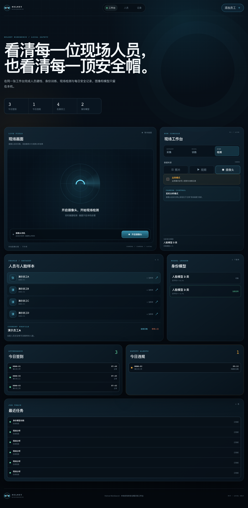

# Helmet Workbench

**A local safety-helmet monitoring and employee recognition workbench**

[中文](../README.md) · [Architecture](architecture.md) · [Privacy](privacy.md) · [Model Card](model-card.md) · [MIT License](../LICENSE)

Helmet Workbench turns a collection of legacy YOLO detection, face classification, PyQt screens, SQLite queries and video-player scripts into one local-first web product. It provides employee enrollment, face sample collection and training, helmet detection, attendance, violation records and daily reporting in one workspace.



> The screenshot is from a real running session. Field footage, employee names and face samples were redacted.

## Features

- Complete workflow: employee profile → sample collection → model training → model activation → field detection → attendance and violation records.
- Three source types: photo, video and browser camera.
- Joint helmet and identity recognition: YOLO detects helmet status while Haar + CNN identifies employees.
- Manageable employee data: delete individual samples, continue collecting, deactivate employees and retain audit history.
- Local-first privacy: listens on `127.0.0.1` by default and never uploads media, models or results to external services.
- Persistent jobs and model history with progress, structured errors, stable label order and activation controls.
- Responsive interface with keyboard focus, semantic labels and reduced-motion support.

## Quick Start

Requirements: Python 3.11–3.12, Node.js 20+, pnpm 10+ and a modern browser.

```bash
git clone https://github.com/panvv-ai/Helmet-Identification.git
cd Helmet-Identification

uv sync --extra dev
pnpm --dir frontend install
pnpm --dir frontend build

uv run python main.py
```

Open <http://127.0.0.1:8000>.

The default command initializes runtime directories, the database and the model before starting the workbench. The helmet detector is distributed as a versioned GitHub Release artifact and verified by SHA-256 before use.

## Workflow Rules

- Add at least two employees and collect at least two readable face samples per employee.
- Train an identity model and activate the desired version.
- Photo and video analyses are non-recording by default.
- Camera business mode is the only mode that writes formal attendance and violation records.
- Attendance requires a recognized, helmet-wearing employee; violations are recorded once per employee per day.

## Commands

```bash
uv run python main.py serve
uv run python main.py download-models
uv run python main.py train --epochs 8
uv run python main.py detect path/to/photo.jpg
uv run python main.py upgrade-db
```

## Development

```bash
uv run python main.py serve
pnpm --dir frontend dev
```

The Vite development server proxies `/api` and WebSocket traffic to FastAPI.

## Verification

```bash
uv run pytest
uv run ruff check src tests scripts main.py
uv run mypy
pnpm --dir frontend lint
pnpm --dir frontend typecheck
pnpm --dir frontend test:run
pnpm --dir frontend test:e2e
pnpm --dir frontend build
```

## Architecture

The backend uses FastAPI, SQLAlchemy 2, Alembic, SQLite, OpenCV and TensorFlow. The frontend uses React and Vite. Runtime data is stored below `storage/` and is excluded from Git.

See [Architecture](architecture.md) and the [Model Card](model-card.md) for design and model details.

## Privacy and Limitations

This release is a single-user local application. It does not provide authentication, remote multi-tenancy, liveness detection or production-grade identity verification. Obtain consent before collecting biometric face data and follow applicable privacy law.

See [Privacy](privacy.md) for details.

## Legacy Changes

The legacy PyQt interface, duplicate YOLO implementations, unused FaceNet/MTCNN path, sample video, fonts and old SQLite file have been removed. Legacy business data is not imported automatically, and the old face model is unsupported because its output labels do not match the stored employee records.

## License

[MIT License](../LICENSE). Copyright © 2026 Helmet-Identification contributors.
